# ddd-hexagonal-lab

Una tienda mínima (catálogo, pedidos y notificaciones) en la que **cada concepto de DDD y de
arquitectura hexagonal aparece una vez, aplicado de forma pura y señalado en el código**. El dominio
es pequeño a propósito: lo que importa no es la tienda, sino poder abrir una clase y ver un agregado,
un puerto o una capa anticorrupción de verdad, con su porqué al lado.

- **Java 21 · Spring Boot 4.0 · Gradle multi-módulo · H2 en memoria · ArchUnit.**
- **Monolito modular**: un solo desplegable con tres bounded contexts que solo se hablan por su API
  pública o por eventos. En la [sección 3.5](#35-por-qué-un-monolito-modular-y-no-microservicios)
  se explica por qué no son microservicios.
- **57 tests** en verde. Las reglas de negocio (19 tests de dominio) se ejecutan en **0,08 s** sin
  Spring ni base de datos; los 6 end-to-end tardan 4,3 s.

> **Cómo leer el código.** Cada clase importante lleva en su Javadoc una etiqueta con el concepto que
> implementa: `[DDD · Value Object]`, `[Hexagonal · puerto de salida]`, `[Context map · Anticorruption Layer]`…
> Para ver todas las piezas de un concepto, búscalo:
>
> ```bash
> grep -rn "\[Hexagonal · adaptador" --include=*.java .
> grep -rn "\[Context map" --include=*.java .
> ```

## Índice

0. [Arrancar en un minuto](#0-arrancar-en-un-minuto)
1. [El proyecto de un vistazo](#1-el-proyecto-de-un-vistazo)
2. [El negocio: qué hace la tienda y qué reglas tiene](#2-el-negocio-qué-hace-la-tienda-y-qué-reglas-tiene)
3. [DDD estratégico: cómo se ha partido el sistema](#3-ddd-estratégico-cómo-se-ha-partido-el-sistema)
4. [DDD táctico: cómo se ha modelado el core](#4-ddd-táctico-cómo-se-ha-modelado-el-core)
5. [Arquitectura hexagonal: cómo se ha aislado el core](#5-arquitectura-hexagonal-cómo-se-ha-aislado-el-core)
6. [Recorridos completos, paso a paso](#6-recorridos-completos-paso-a-paso)
7. [Los tests como prueba de la arquitectura](#7-los-tests-como-prueba-de-la-arquitectura)
8. [Antipatrones que este proyecto evita](#8-antipatrones-que-este-proyecto-evita)
9. [Decisiones y lo que cambiaría en producción](#9-decisiones-y-lo-que-cambiaría-en-producción)
10. [Chuleta: cada concepto y dónde está](#10-chuleta-cada-concepto-y-dónde-está)
11. [Ejercicios para practicar](#11-ejercicios-para-practicar)

---

## 0. Arrancar en un minuto

Solo hace falta un JDK 21. Gradle se descarga solo con el wrapper.

```bash
./gradlew test               # los 57 tests (dominio, casos de uso, ACL, arquitectura, end-to-end)
./gradlew :app:bootRun       # arranca en http://localhost:8080 con tres productos de demo
```

El fichero [`requests.http`](requests.http) tiene el recorrido completo listo para lanzar desde
IntelliJ o VS Code. Con curl, y con las respuestas reales:

```bash
curl -s localhost:8080/products
# [{"id":"keyboard","name":"Teclado mecánico",...,"price":{"amount":89.90,"currency":"EUR"}}, ...]

curl -s -X POST localhost:8080/orders -H 'Content-Type: application/json' \
  -d '{"customerId":"ana","items":[{"productId":"keyboard","quantity":1},{"productId":"mouse","quantity":2}]}'
# {"orderId":"9683b8ef-0f06-42e8-9bcb-84a1fb6797e1"}

curl -s -X POST localhost:8080/orders/{id}/payment        # 204, cobrado a través de la ACL de LegacyPay
curl -s -X POST localhost:8080/orders/{id}/shipment       # 204
curl -s -X POST localhost:8080/orders/{id}/cancellation   # 409: la regla de negocio, con su nombre
# {"title":"OrderAlreadyShipped","status":409,
#  "detail":"El pedido 9683b8ef-... ya se ha enviado y no se puede cancelar"}
```

Los errores del API llevan en `title` el nombre de la regla de negocio que se ha intentado romper:

| Petición | Respuesta | Quién lo decide |
|---|---|---|
| Cantidad `0` | `400 InvalidInput` · "La cantidad debe estar entre 1 y 99 y es 0" | El value object [`Quantity`][Quantity] |
| Producto que no existe | `404 ProductNotFound` | El caso de uso [`PlaceOrderService`][PlaceOrderService] |
| Cuarto pedido sin pagar del mismo cliente | `409 TooManyUnpaidOrders` | El servicio de dominio [`UnpaidOrdersLimit`][UnpaidOrdersLimit] |
| Añadir un producto a un pedido enviado | `409 OrderCannotBeModified` | El agregado [`Order`][Order] |
| Cancelar un pedido enviado | `409 OrderAlreadyShipped` | El agregado [`Order`][Order] |
| Pagar 3 monitores (1047 €) | `402 PaymentRejected` · "fondos insuficientes" | LegacyPay responde `"51"` y la [ACL][LegacyPayPaymentGateway] lo traduce |

---

## 1. El proyecto de un vistazo

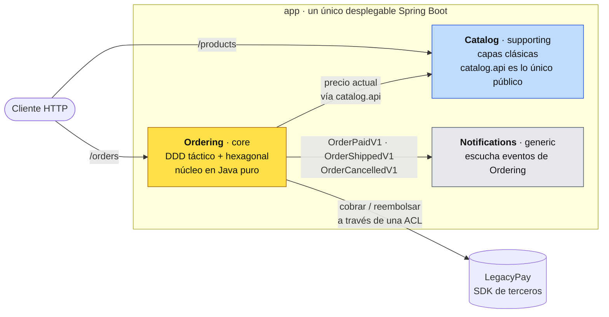

Cada contexto guarda sus datos en su propio esquema de H2 (`catalog`, `ordering`) y comparten un
único value object, `Money` (el Shared Kernel). Las flechas son todas las formas en que se hablan:
no hay más.

| Módulo Gradle | Qué es | Concepto principal | Depende de |
|---|---|---|---|
| [`shared-kernel`](shared-kernel) | `Money` | Shared Kernel, Value Object | nada |
| [`catalog`](catalog) | Productos y precios | Subdominio supporting en capas clásicas, Open Host Service | `shared-kernel`, Spring |
| [`ordering/domain`](ordering/domain) | Pedidos: reglas de negocio | Agregado, entidades, VOs, eventos, repositorio, servicio de dominio | **solo** `shared-kernel` |
| [`ordering/application`](ordering/application) | Casos de uso y puertos | Application services, puertos de entrada y salida | **solo** `ordering/domain` |
| [`ordering/contracts`](ordering/contracts) | Eventos públicos de Ordering | Published Language, eventos de integración | **nada** |
| [`ordering/infrastructure`](ordering/infrastructure) | Adaptadores y cableado | Adaptadores driving y driven, ACL, composition root | lo anterior + Spring |
| [`notifications`](notifications) | Emails | Subdominio generic, Conformist | `ordering/contracts`, Spring |
| [`legacy-pay-sdk`](legacy-pay-sdk) | Pasarela de pagos "de terceros" | El modelo ajeno del que protege la ACL | nada |
| [`app`](app) | `main`, configuración, tests globales | Monolito modular, ArchUnit, end-to-end | todo |

La columna "Depende de" no es una convención: son las dependencias de cada `build.gradle.kts`. El
módulo [`ordering/domain`][domain-build] no tiene Spring en el classpath, así que **escribir
`@Service` en el dominio no compila** (lo verás en la [sección 5.6](#56-quién-vigila-la-regla-el-compilador-y-archunit)).

Dentro de cada módulo, los paquetes cuelgan de `com.borjaglez.dddlab`:

```text
ddd-hexagonal-lab/
├── shared-kernel/            sharedkernel/        Money
├── catalog/                  catalog/
│   ├── api/                                       CatalogApi, ProductView   ← lo único público
│   └── internal/                                  Product (@Entity), CatalogService, CatalogController
├── ordering/
│   ├── domain/               ordering/domain/
│   │                                              Order, OrderLine, OrderStatus, CancellationReason
│   │                                              OrderId, CustomerId, ProductId, PaymentId, Quantity
│   │                                              OrderRepository (puerto), UnpaidOrdersLimit (servicio)
│   │                                              AggregateRoot
│   │   ├── event/                                 DomainEvent (sealed), OrderPlaced, OrderPaid, ...
│   │   └── exception/                             OrderAlreadyShipped, TooManyUnpaidOrders, ...
│   ├── application/          ordering/application/
│   │   ├── port/in/                               PlaceOrderUseCase, PayOrderUseCase, ... + comandos
│   │   ├── port/out/                              ProductCatalog, PaymentGateway, DomainEventPublisher, OrderViews
│   │   ├── service/                               PlaceOrderService, PayOrderService, ...
│   │   └── exception/                             OrderNotFound, ProductNotFound, PaymentRejected
│   ├── contracts/            ordering/contracts/  OrderPlacedV1, OrderPaidV1, OrderShippedV1, OrderCancelledV1
│   └── infrastructure/       ordering/infrastructure/
│       ├── config/                                OrderingConfiguration (aquí Spring conoce el núcleo)
│       ├── in/rest/                               OrderController, OrderingExceptionHandler
│       ├── in/scheduling/                         ExpiredOrdersJob
│       ├── in/events/                             OrderCancelledListener
│       ├── out/persistence/                       JpaOrderRepository, OrderJpaEntity, OrderMapper, JpaOrderViews
│       ├── out/catalog/                           CatalogProductCatalog
│       ├── out/payment/                           LegacyPayPaymentGateway (ACL), LegacyPayConfiguration
│       └── out/events/                            SpringDomainEventPublisher, IntegrationEventPublisher
├── notifications/            notifications/       OrderNotificationsListener, EmailSender
├── legacy-pay-sdk/           com.legacypay.sdk    LegacyPayClient, LpTransactionRequest, LpTransactionResponse
└── app/                                           DddLabApplication, application.yml, ArchitectureTest, OrderLifecycleTest
```

---

## 2. El negocio: qué hace la tienda y qué reglas tiene

Un cliente elige productos del catálogo y **realiza un pedido**. El precio se toma del catálogo en
ese momento y **queda congelado**. Mientras no lo paga puede **añadir productos**. Lo **paga** (a
través de una pasarela externa), el almacén lo **envía**, y en cualquier momento antes del envío se
puede **cancelar**; si estaba pagado, **se reembolsa**. Un pedido sin pagar **caduca** a los 30
minutos. El cliente recibe un email en cada paso importante.

### 2.1 Event Storming

El [Event Storming](https://www.eventstorming.com/) es la técnica de descubrimiento de la que
salen los bounded contexts: post-its de eventos (naranja) en una línea temporal, los comandos que
los provocan (azul), los agregados que los procesan (amarillo), las políticas "cuando X, entonces Y"
(lila), los sistemas externos (rosa) y la información que se consulta (verde). Este es el resultado
para la tienda; cada post-it tiene su clase con el mismo nombre:

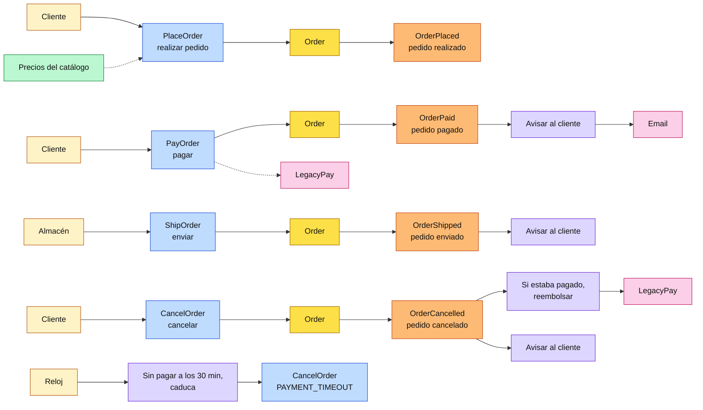

Al agrupar los post-its salen tres zonas con lenguaje propio: lo que se **vende** (catálogo), lo que
se **compra** (pedidos) y lo que se **avisa** (notificaciones). Esas zonas son los bounded contexts.

### 2.2 Las reglas de negocio, dónde viven y qué test las prueba

| # | Regla | Dónde vive (una sola vez) | Test que la prueba |
|---|---|---|---|
| R1 | Un pedido tiene entre 1 y 10 productos distintos | [`Order.place`][Order] / `addLine` → `EmptyOrder`, `TooManyLines` | [`OrderTest`][OrderTest] `Placing` |
| R2 | Cada línea lleva entre 1 y 99 unidades | [`Quantity`][Quantity] | `OrderLifecycleTest.invalidInputIsRejectedByTheValueObjects` |
| R3 | El precio se congela al comprar | [`OrderLine`][OrderLine] + [`PlaceOrderService`][PlaceOrderService] | `PlaceOrderServiceTest.theOrderKeepsThePriceItWasBoughtAt` |
| R4 | Solo se añaden productos a un pedido sin pagar | `Order.addLine` → `OrderCannotBeModified` | `OrderTest.aPaidOrderCannotBeModified` |
| R5 | Ciclo de vida PLACED → PAID → SHIPPED; se cancela desde PLACED o PAID | [`OrderStatus`][OrderStatus] | [`OrderTest`][OrderTest] `Lifecycle` |
| R6 | Un pedido enviado no se puede cancelar | `Order.cancel` → [`OrderAlreadyShipped`][OrderAlreadyShipped] | `OrderTest.aShippedOrderCannotBeCancelled` |
| R7 | Al cancelar un pedido pagado, se reembolsa | [`OrderCancelled`][OrderCancelled]`.wasPaid()` + [`RefundCancelledOrderService`][RefundCancelledOrderService] | `CancellationTest`, `OrderLifecycleTest` |
| R8 | Un cliente no acumula más de 3 pedidos sin pagar | [`UnpaidOrdersLimit`][UnpaidOrdersLimit] | [`UnpaidOrdersLimitTest`][UnpaidOrdersLimitTest] |
| R9 | Un pedido sin pagar caduca a los 30 minutos | `Order.PAYMENT_DEADLINE` + [`CancelExpiredOrdersService`][CancelExpiredOrdersService] | `CancellationTest.unpaidOrdersOlderThanTheDeadline...` |
| R10 | No se cobra un pedido cancelado | `Order.ensureCanBePaid` | `PayOrderServiceTest.aCancelledOrderIsNeverCharged` |

Ninguna regla está en un controlador, en un listener, en un job ni en una query. Esa tabla es,
resumida, todo el valor de DDD táctico más hexagonal.

---

## 3. DDD estratégico: cómo se ha partido el sistema

DDD estratégico decide **dónde van los límites y cómo se relacionan las partes**. Casi siempre
compensa, porque partir bien y nombrar bien es barato y evita errores caros. Por eso se aplica a
los tres contextos, también a los sencillos.

### 3.1 Subdominios: dónde se invierte y dónde no

| Subdominio | Tipo | Qué se aplica | Por qué |
|---|---|---|---|
| **Ordering** (pedidos) | **Core** | Estratégico + táctico completo + hexagonal "de nivel 3" | Es lo que diferencia a la tienda y donde cambian las reglas. Un error aquí cuesta dinero. |
| **Catalog** (productos) | **Supporting** | Estratégico (límite, lenguaje, esquema propios) + **capas clásicas a propósito** | Necesario pero sin invariantes: crear un producto es validar un formulario. Un agregado aquí sería ceremonia. |
| **Payments** (cobros) | **Generic** | **No se construye**: se compra (LegacyPay) y solo se modela la traducción (ACL) | Problema resuelto. Lo único propio es no dejar que su modelo entre en el nuestro. |
| **Notifications** (emails) | **Generic** | Un listener que se conforma con los eventos de Ordering | En un sistema real sería SES o SendGrid. No hay nada que modelar. |

La idea clave es que **DDD táctico y hexagonal se aplican solo en el core**. [`Catalog`][CatalogService]
es el contraejemplo deliberado: compara su `Product` (una `@Entity` con setters) con `Order` y verás
cuánto cuesta cada pieza y por qué solo se paga donde hay reglas que proteger.

### 3.2 Lenguaje ubicuo

El vocabulario del negocio aparece tal cual en el código: en clases, métodos, eventos, excepciones y
hasta en el `title` de los errores del API. Si negocio dice "un pedido enviado no se puede cancelar",
en el código hay un `order.cancel(...)` que lanza `OrderAlreadyShipped`.

| Negocio dice | Significa | En el código |
|---|---|---|
| Pedido | Lo que compra un cliente, con su estado | [`Order`][Order] |
| Línea | Un producto del pedido, con cantidad y precio congelado | [`OrderLine`][OrderLine] |
| Realizar un pedido | Crearlo a partir de productos del catálogo | `Order.place`, [`PlaceOrderUseCase`][PlaceOrderUseCase], `OrderPlaced` |
| Añadir un producto | Sumar una línea, o cantidad a una existente | `Order.addLine`, `AddProductToOrderUseCase` |
| Pagar / cobrar | Cobrar el total a través de la pasarela | `PayOrderUseCase`, [`PaymentGateway`][PaymentGateway]`.charge`, `Order.markAsPaid`, `OrderPaid` |
| Enviar | Sacarlo del almacén | `Order.ship`, `OrderShipped` |
| Cancelar | Anularlo antes del envío | `Order.cancel`, `OrderCancelled`, `CancellationReason` |
| Reembolsar | Devolver lo cobrado | `PaymentGateway.refund`, `RefundCancelledOrderUseCase` |
| Pedido sin pagar | Realizado y no pagado | `OrderStatus.PLACED`, `OrderRepository.countUnpaidBy` |
| Caducar | Cancelarse solo al pasar el plazo de pago | `Order.PAYMENT_DEADLINE`, `CancelExpiredOrdersUseCase`, `PAYMENT_TIMEOUT` |

Nada se llama `updateStatus`, `processOrder`, `OrderManager` ni `setPaid(true)`. El lenguaje es
válido **solo dentro de su bounded context**: la siguiente sección lo demuestra.

### 3.3 Bounded contexts: la misma palabra, modelos distintos

"Producto" significa cosas distintas según quién hable, y eso es correcto. Intentar un único
`Product` para todos crea un modelo gigante que nadie entiende y que rompe a varios equipos con cada
cambio.

<table>
<tr><th>"Producto" en <b>Catalog</b></th><th>"Producto" en <b>Ordering</b></th></tr>
<tr><td>

```java
// catalog.api.ProductView
public record ProductView(
    String id,
    String name,
    String description,   // para la tienda
    Money price) {}       // el precio de HOY
```

</td><td>

```java
// ordering.domain.OrderLine
public final class OrderLine {
  private final ProductId productId;
  private final String productName;
  private final Money unitPrice;  // CONGELADO al comprar
  private Quantity quantity;      // cuántos
  ...
}
```

</td></tr>
<tr><td>Lo que se enseña en el escaparate. Cambia cuando marketing quiere.</td>
<td>Lo que se compró y a qué precio. No cambia aunque Catalog suba el precio mañana.</td></tr>
</table>

Cada contexto tiene su **módulo**, su **paquete raíz** (`com.borjaglez.dddlab.catalog`,
`...ordering`, `...notifications`) y su **esquema de base de datos** (`catalog`, `ordering`, ver
[`application.yml`][application.yml]). Ningún contexto lee tablas de otro.

### 3.4 Context map: cómo se relacionan los contextos

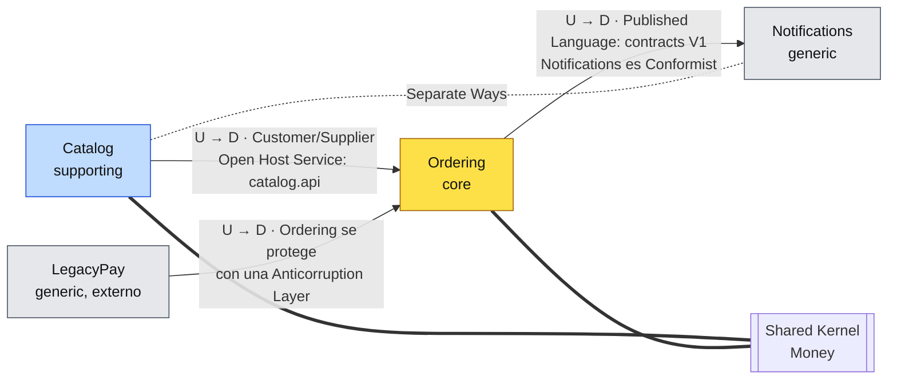

`U` es upstream (quien define el modelo) y `D` es downstream (quien lo consume). Los seis patrones
del context map están en el código:

| Patrón | Entre | Dónde | Por qué así |
|---|---|---|---|
| **Customer/Supplier** | Catalog (U) → Ordering (D) | [`CatalogApi`][CatalogApi] está pensado para lo que Ordering necesita (consultar un producto y su precio) | Catalog atiende a su cliente; Ordering puede pedirle cambios. |
| **Open Host Service** | Catalog | Paquete `catalog.api`: [`CatalogApi`][CatalogApi] + [`ProductView`][ProductView]. Todo `catalog.internal` es privado | Un único protocolo estable para cualquier consumidor. ArchUnit prohíbe tocar `internal`. |
| **Anticorruption Layer** | LegacyPay (U) → Ordering (D) | [`LegacyPayPaymentGateway`][LegacyPayPaymentGateway] traduce céntimos, `respCode "51"` y `txnId` a `Money`, `PaymentResult` y `PaymentId` | El modelo de un tercero (JavaBeans mutables, códigos crípticos) no puede contaminar el dominio. Si cambia la pasarela, solo cambia esta clase. |
| **Published Language** | Ordering → cualquiera | Módulo [`ordering/contracts`][contracts]: `OrderPaidV1`, `OrderCancelledV1`… solo tipos del JDK, versionados en el nombre | Un contrato público estable que no arrastra el modelo interno. Un cambio incompatible crea `V2`, no modifica `V1`. |
| **Conformist** | Ordering (U) → Notifications (D) | [`OrderNotificationsListener`][OrderNotificationsListener] usa los `...V1` tal cual, sin traducirlos | Para mandar un email no merece la pena un modelo propio. |
| **Shared Kernel** | Catalog ↔ Ordering | [`Money`][Money] en el módulo `shared-kernel` | Los dos necesitan el mismo concepto de importe. Es diminuto a propósito, porque cualquier cambio en él obliga a coordinar a los dos equipos. |
| **Separate Ways** | Catalog ↔ Notifications | No hay dependencia (ArchUnit lo comprueba) | El email no necesita nada del catálogo: lleva lo que trae el evento. |

### 3.5 Por qué un monolito modular y no microservicios

DDD no exige microservicios. Un bounded context es un buen candidato a servicio, pero empezar con
un **monolito modular** (un módulo por contexto) da los beneficios del modelo sin el coste de la red:
transacciones locales, un solo despliegue y depuración sencilla.

Lo importante es que **el corte ya está hecho**. Los contextos solo se tocan a través de dos puntos,
y extraer uno es cambiar ese punto, no desenredar código:

| Si Catalog pasa a ser un microservicio… | Cambia | No cambia |
|---|---|---|
| Ordering le pregunta precios | [`CatalogProductCatalog`][CatalogProductCatalog] pasa de llamar a `CatalogApi` en memoria a ser un cliente HTTP | El puerto [`ProductCatalog`][ProductCatalog], el caso de uso y el dominio |

| Si Notifications pasa a ser un microservicio… | Cambia | No cambia |
|---|---|---|
| Recibe los eventos | [`IntegrationEventPublisher`][IntegrationEventPublisher] escribe en un outbox y un relay los manda a Kafka | Los contratos `...V1`, Ordering entero |

---

## 4. DDD táctico: cómo se ha modelado el core

Todo lo de esta sección vive en [`ordering/domain`](ordering/domain) y
[`ordering/application`](ordering/application): Java puro, sin una sola anotación.

### 4.1 Value Objects

**Qué es.** Un objeto que se define por sus valores, no tiene identidad y es inmutable.
`Money.euros("10")` es igual a cualquier otro `Money.euros("10.00")`.

**Dónde.** [`Money`][Money], [`Quantity`][Quantity], [`OrderId`][OrderId],
[`CustomerId`][CustomerId], [`ProductId`][ProductId], [`PaymentId`][PaymentId]. Son `record` de
Java 21.

```java
public record Quantity(int value) {
  public static final int MAX = 99;

  public Quantity {                       // se valida al construir:
    if (value < 1 || value > MAX) {       // una Quantity inválida no puede existir
      throw new IllegalArgumentException("La cantidad debe estar entre 1 y " + MAX + " y es " + value);
    }
  }

  public Quantity add(Quantity other) {   // inmutable: devuelve otra
    return new Quantity(value + other.value);
  }
}
```

**Por qué.** Eliminan el *primitive obsession*: la regla "entre 1 y 99" está en un sitio y no se
repite en el controlador, en el servicio y en la base de datos. Los ids tipados hacen que el
compilador impida pasar un `CustomerId` donde se espera un `OrderId`. `Money` escala los importes a
dos decimales en el constructor para que `10` y `10.00` sean iguales y para que nunca haya un
`double` con redondeos raros.

### 4.2 Entidades

**Qué es.** Un objeto con identidad que persiste en el tiempo aunque cambien sus atributos. Dos
pedidos con los mismos datos siguen siendo dos pedidos.

**Dónde.** [`Order`][Order] (identidad global, `OrderId`) y [`OrderLine`][OrderLine] (identidad
local dentro del pedido: el `ProductId`).

```java
// Order: igualdad por identidad, no por valores
@Override
public boolean equals(Object other) {
  return other instanceof Order order && id.equals(order.id);
}
```

**Por qué `OrderLine` es una entidad y no un VO.** Tiene identidad dentro del pedido y cambia: si
se añade otra vez el mismo producto, *esa* línea suma cantidad (`increaseBy`) en vez de crearse
otra. Lo prueba `OrderTest.theSameProductTwiceIsOneLineWithBothQuantities`.

### 4.3 Agregado y Aggregate Root

**Qué es.** Un grupo de entidades y VOs que se trata como **una unidad de consistencia**. Solo se
accede a él a través de su raíz, que protege las **invariantes** (las reglas que se cumplen siempre).

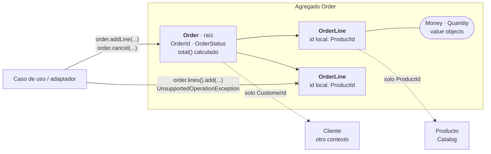

**Dónde.** [`Order`][Order] extiende [`AggregateRoot`][AggregateRoot]. Sus invariantes, escritas en
el Javadoc y en el código:

1. Entre 1 y 10 líneas, todas en la misma divisa.
2. Solo se añaden productos mientras está `PLACED`.
3. El estado sigue `OrderStatus`; un pedido enviado no se cancela.
4. El total no se guarda: se calcula de las líneas, así nunca se desincroniza.

```java
public void addLine(OrderLine line) {
  if (status != OrderStatus.PLACED) {
    throw new OrderCannotBeModified(id, status);       // invariante 2
  }
  ...
  Optional<OrderLine> existing = lineFor(line.productId());
  if (existing.isPresent()) {
    existing.get().increaseBy(line.quantity());         // package-private: solo la raíz puede
    return;
  }
  if (lines.size() == MAX_LINES) {
    throw new TooManyLines(MAX_LINES);                  // invariante 1
  }
  lines.add(line);
}

public List<OrderLine> lines() {
  return List.copyOf(lines);                            // se puede mirar, no tocar
}
```

**Las cuatro reglas de Vernon para diseñar agregados, y cómo se cumplen aquí:**

| Regla | Aquí |
|---|---|
| Protege invariantes verdaderas dentro del límite | Todo lo que debe ser consistente al instante (líneas, total, estado) está dentro de `Order`. |
| Agregados pequeños | `Order` contiene solo sus líneas. El cliente no contiene sus pedidos (eso sería un "Customer con todos sus pedidos", el error clásico de contención). |
| Referencia a otros agregados solo por id | `CustomerId` y `ProductId`, nunca un objeto `Customer` o `Product`. |
| Una transacción modifica un solo agregado | Cada caso de uso carga, cambia y guarda **un** pedido. [`CancelExpiredOrdersService`][CancelExpiredOrdersService] cancela N pedidos en **N transacciones**, delegando en `CancelOrderUseCase`. Entre agregados y contextos, consistencia eventual con eventos (reembolso, emails). |

La concurrencia también es del agregado: [`OrderJpaEntity`][OrderJpaEntity] tiene `@Version`. Si dos
peticiones cambian el mismo pedido a la vez, la segunda falla en el `UPDATE`, y el dominio no sabe
nada de versiones.

### 4.4 Modelo rico frente a modelo anémico

El requisito: *"un pedido enviado no se puede cancelar; al cancelar uno pagado hay que reembolsar"*.

<table>
<tr><th>Anémico (lo que <b>no</b> hay aquí)</th><th>Rico (lo que hay en <code>Order</code>)</th></tr>
<tr><td>

```java
class OrderService {
  void cancel(UUID id) {
    Order o = repo.findById(id).orElseThrow();
    if (o.getStatus() == SHIPPED) throw ...;
    o.setStatus(CANCELLED);
    if (o.isPaid()) payments.refund(o.getId());
  }
}
// ...y el job de caducados, otro día:
repo.findExpired()
    .forEach(o -> o.setStatus(CANCELLED));
// bug: ni comprueba SHIPPED ni reembolsa
```

</td><td>

```java
public void cancel(CancellationReason reason,
                   Instant now) {
  if (status == OrderStatus.SHIPPED) {
    throw new OrderAlreadyShipped(id);
  }
  requireTransitionTo(CANCELLED, "cancelar");
  this.status = OrderStatus.CANCELLED;
  recordEvent(new OrderCancelled(
      id, customerId, reason,
      paymentId, total(), now));
  // el reembolso reacciona al evento
}
```

</td></tr>
</table>

Con el modelo rico **el bug del job no puede existir**, porque no hay `setStatus`. El REST y el job
llaman a lo mismo (`order.cancel`). Reembolsar y avisar al cliente son suscriptores de
`OrderCancelled`: añadir un tercero no toca `Order`. Es *tell, don't ask*: se le dice al pedido qué
hacer, no se le pregunta su estado para decidir fuera.

Y el anémico tiene su sitio: [`Product`][Product] en Catalog es anémico, y **está bien**, porque no
tiene reglas que proteger.

### 4.5 Factory: crear no es lo mismo que reconstruir

```java
// Crear: valida TODAS las invariantes y anota el hecho. No existe un Order a medio hacer.
public static Order place(OrderId id, CustomerId customerId, List<OrderLine> lines, Instant now) {
  if (lines.isEmpty()) throw new EmptyOrder();
  Order order = new Order(id, customerId, List.of(), now, OrderStatus.PLACED, null);
  lines.forEach(order::addLine);                                   // reutiliza las reglas de addLine
  order.recordEvent(new OrderPlaced(id, customerId, order.total(), now));
  return order;
}

// Reconstruir (lo usa el repositorio): el pedido ya existía, no ha pasado nada nuevo → sin eventos.
public static Order reconstitute(OrderId id, CustomerId customerId, List<OrderLine> lines,
                                 Instant placedAt, OrderStatus status, PaymentId paymentId) { ... }
```

El constructor es privado. La factory es un método estático porque la creación cabe en el propio
agregado; con una construcción más compleja (varias fuentes, reglas de numeración) sería una clase
`OrderFactory`.

### 4.6 Eventos de dominio frente a eventos de integración

Un evento es un **hecho de negocio que ya ocurrió**, con nombre en pasado. Hay dos tipos, y
mezclarlos es un error común:

| | Evento de dominio | Evento de integración |
|---|---|---|
| Ejemplo | [`OrderCancelled`][OrderCancelled] | [`OrderCancelledV1`][OrderCancelledV1] |
| Alcance | Dentro de Ordering | Cruza contextos: es un contrato público |
| Tipos | Del dominio: `OrderId`, `Money`, `CancellationReason` | Solo del JDK: `String`, `BigDecimal`, `boolean` |
| Estabilidad | Cambia cuando cambia el modelo | Estable y versionado (`V1`, `V2`…) |
| Módulo | `ordering/domain` | `ordering/contracts` (sin dependencias) |
| Quién lo escucha | Políticas de Ordering (reembolso) | Otros contextos (Notifications) |

Cómo circulan:

1. El agregado **anota** el evento (`recordEvent`). No lo publica, porque no conoce ningún bus.
2. El caso de uso, tras guardar, lo entrega al puerto [`DomainEventPublisher`][DomainEventPublisher]
   con `order.pullDomainEvents()`.
3. Tras el **commit**, el adaptador [`IntegrationEventPublisher`][IntegrationEventPublisher] traduce
   cada evento de dominio a su `...V1` y lo publica.

`DomainEvent` es una interfaz **`sealed`**, así que el `switch` que traduce a eventos de integración
es exhaustivo: si alguien añade un evento de dominio nuevo y no decide qué se publica, **no
compila**.

### 4.7 Repository

**Qué es.** Una abstracción con forma de colección para cargar y guardar **agregados completos**.
Hay uno por raíz (no uno por tabla), y su interfaz pertenece al dominio.

```java
public interface OrderRepository {             // en ordering/domain
  Optional<Order> findById(OrderId id);
  void save(Order order);
  long countUnpaidBy(CustomerId customerId);
  List<OrderId> findUnpaidPlacedBefore(Instant moment);
}
```

Habla el idioma del dominio: recibe y devuelve `Order`, nunca `OrderJpaEntity` ni `Page<>` de
Spring. Tiene **dos implementaciones**: [`JpaOrderRepository`][JpaOrderRepository] (la real) e
[`InMemoryOrderRepository`][InMemoryOrderRepository] (la de los tests). Por eso la interfaz con "una
sola implementación" no es sobreingeniería.

¿Por qué `OrderRepository` está en `domain` y `PaymentGateway` en `application`? Porque el
repositorio solo habla de agregados (es un concepto del dominio y lo usa también el servicio de
dominio), mientras que cobrar es una necesidad del caso de uso. Es la estructura que propone el
libro azul y la que se ve en la mayoría de proyectos DDD.

### 4.8 Domain Service

**Qué es.** Lógica de dominio que no encaja en una entidad ni en un VO, normalmente porque mira
varios agregados. No tiene estado.

```java
/** Regla: un cliente no puede acumular más de 3 pedidos sin pagar. */
public final class UnpaidOrdersLimit {
  public void checkCanPlaceOrder(CustomerId customerId) {
    if (orders.countUnpaidBy(customerId) >= MAX_UNPAID_ORDERS) {
      throw new TooManyUnpaidOrders(customerId, MAX_UNPAID_ORDERS);
    }
  }
}
```

No puede vivir en `Order`, porque un pedido no sabe nada de los otros pedidos del cliente. Tampoco
en el caso de uso, porque es una regla de negocio y no orquestación. Lo que la hace "de dominio" es
que solo depende de un puerto del dominio ([`OrderRepository`][OrderRepository]).

### 4.9 Application Service (caso de uso)

**Qué es.** Orquesta: carga el agregado, le pide que haga el cambio, lo guarda y publica los
eventos. **No contiene reglas de negocio.**

```java
public OrderId place(PlaceOrderCommand command) {
  unpaidOrdersLimit.checkCanPlaceOrder(command.customerId());          // 1. reglas entre agregados
  List<OrderLine> lines = command.items().stream()
      .map(this::lineAtCurrentPrice).toList();                         // 2. datos de fuera, vía puertos
  Order order = Order.place(OrderId.newId(), command.customerId(),
                            lines, clock.instant());                   // 3. el dominio decide
  orders.save(order);                                                  // 4. guardar
  events.publish(order.pullDomainEvents());                            //    y publicar
  return order.id();
}
```

Fíjate en que no hay ningún `if` de negocio. [`PlaceOrderService`][PlaceOrderService] tampoco lleva
`@Service` ni `@Transactional`: la transacción se la pone infraestructura alrededor
([sección 5.7](#57-spring-vive-en-el-anillo-de-fuera)). El tiempo entra como un `java.time.Clock`
inyectado, así que los tests usan un reloj fijo y "han pasado 31 minutos" se prueba sin esperar.

### 4.10 Excepciones con nombre de negocio

[`DomainException`][DomainException] tiene una subclase por regla: `OrderAlreadyShipped`,
`OrderCannotBeModified`, `TooManyUnpaidOrders`, `TooManyLines`, `EmptyOrder` e
`IllegalOrderStateTransition`. El adaptador REST las convierte en `409` con el nombre en `title`, así
que **el lenguaje ubicuo llega hasta quien consume el API**. Saber que `OrderAlreadyShipped` es un
409 es cosa del adaptador ([`OrderingExceptionHandler`][OrderingExceptionHandler]), no del dominio.

### 4.11 La máquina de estados

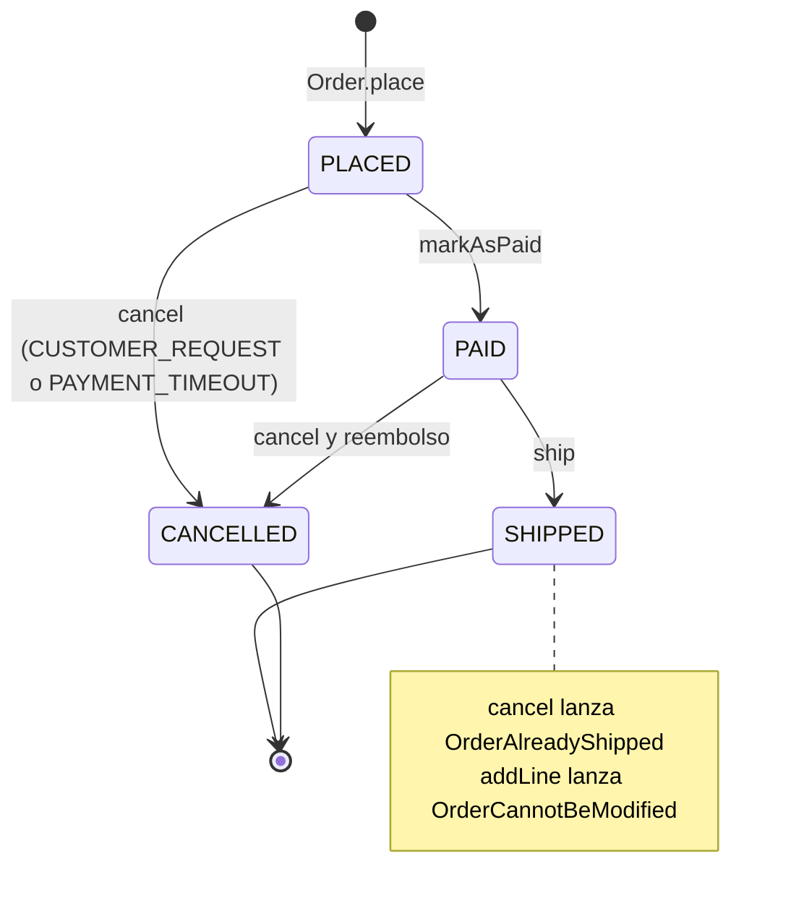

Las transiciones viven en [`OrderStatus.canTransitionTo`][OrderStatus], un `switch` exhaustivo
sobre el enum.

---

## 5. Arquitectura hexagonal: cómo se ha aislado el core

La idea en una frase: **el núcleo de negocio no depende de nada técnico; todo lo técnico depende
del núcleo.** DDD dice *qué* hay dentro del hexágono (agregados, VOs, eventos); hexagonal dice
*cómo aislarlo* del exterior.

### 5.1 El hexágono de Ordering

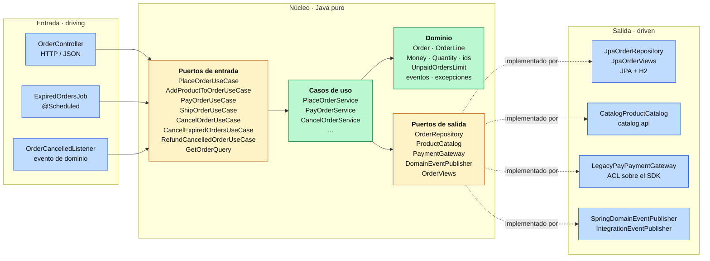

El diagrama sigue el camino de una llamada, de izquierda a derecha: un adaptador de entrada llama a
un puerto de entrada, el caso de uso usa el dominio y pide al exterior lo que necesita a través de
un puerto de salida, y en tiempo de ejecución ese puerto lo atiende un adaptador. **Las dependencias
del código van al revés que las llamadas por la derecha**: los adaptadores de salida implementan
interfaces que define el núcleo, así que son ellos los que dependen del núcleo, nunca al revés
([sección 5.5](#55-la-regla-de-dependencias)). El núcleo no sabe que existen HTTP, JPA, LegacyPay ni
Spring.

### 5.2 Puertos de entrada (driving): lo que la aplicación ofrece

| Puerto ([`port/in`](ordering/application/src/main/java/com/borjaglez/dddlab/ordering/application/port/in)) | Lo implementa | Lo usa |
|---|---|---|
| `PlaceOrderUseCase` | `PlaceOrderService` | `OrderController` |
| `AddProductToOrderUseCase` | `AddProductToOrderService` | `OrderController` |
| `PayOrderUseCase` | `PayOrderService` | `OrderController` |
| `ShipOrderUseCase` | `ShipOrderService` | `OrderController` |
| `CancelOrderUseCase` | `CancelOrderService` | `OrderController` **y** `CancelExpiredOrdersService` |
| `CancelExpiredOrdersUseCase` | `CancelExpiredOrdersService` | `ExpiredOrdersJob` |
| `RefundCancelledOrderUseCase` | `RefundCancelledOrderService` | `OrderCancelledListener` |
| `GetOrderQuery` (lectura) | `GetOrderService` | `OrderController` |

Los comandos (`PlaceOrderCommand`, `CancelOrderCommand`…) llegan **ya en value objects**: si un
comando existe, sus datos son válidos. El controlador traduce el JSON a VOs, y es ahí donde
`new Quantity(0)` falla con un 400.

> **Sobre los puertos de entrada con una sola implementación.** Muchos equipos los omiten y dejan que
> el controlador llame a la clase del caso de uso, y es una postura defendible. Aquí están por pureza
> y por un motivo práctico: son la costura donde infraestructura pone la transacción (sección 5.7),
> que es un envoltorio que *implementa la misma interfaz*.

### 5.3 Puertos de salida (driven): lo que la aplicación necesita

| Puerto | Habla de | Adaptador real | Adaptador de test |
|---|---|---|---|
| [`OrderRepository`][OrderRepository] | `Order` | [`JpaOrderRepository`][JpaOrderRepository] | [`InMemoryOrderRepository`][InMemoryOrderRepository] |
| [`ProductCatalog`][ProductCatalog] | `CatalogProduct` (nombre y precio) | [`CatalogProductCatalog`][CatalogProductCatalog] → `catalog.api` | `StubProductCatalog` |
| [`PaymentGateway`][PaymentGateway] | `charge(OrderId, Money)`, `refund(PaymentId, Money)` | [`LegacyPayPaymentGateway`][LegacyPayPaymentGateway] (ACL) | `FakePaymentGateway` |
| [`DomainEventPublisher`][DomainEventPublisher] | `DomainEvent` | [`SpringDomainEventPublisher`][SpringDomainEventPublisher] | `RecordingEventPublisher` |
| [`OrderViews`][OrderViews] (lectura) | `OrderView` | [`JpaOrderViews`][JpaOrderViews] | (no hace falta) |

Los puertos los **define el núcleo, a su medida y en su idioma**: `PaymentGateway.charge(...)` y no
`doTransaction(...)`; `ProductCatalog` devuelve lo que Ordering necesita, no el `ProductView` entero
de Catalog. Un puerto con forma de tecnología (`saveRow`, `sendToTopic`) sería un antipatrón.

### 5.4 Adaptadores

| Adaptador | Tipo | Traduce | Tecnología |
|---|---|---|---|
| [`OrderController`][OrderController] | Entrada | HTTP/JSON → comandos con VOs; resultado → HTTP | Spring MVC |
| [`OrderingExceptionHandler`][OrderingExceptionHandler] | Entrada | Excepciones del núcleo → `ProblemDetail` | Spring MVC |
| [`ExpiredOrdersJob`][ExpiredOrdersJob] | Entrada | Un tic del reloj → `cancelExpiredOrders()` | `@Scheduled` |
| [`OrderCancelledListener`][OrderCancelledListener] | Entrada | Evento `OrderCancelled` (tras commit) → política de reembolso | `@TransactionalEventListener` |
| [`JpaOrderRepository`][JpaOrderRepository] | Salida | `Order` ↔ `OrderJpaEntity` | JPA / Hibernate |
| [`JpaOrderViews`][JpaOrderViews] | Salida | Tablas → `OrderView` sin pasar por el agregado | JPA |
| [`CatalogProductCatalog`][CatalogProductCatalog] | Salida | `ProductView` de Catalog → `CatalogProduct` de Ordering | Llamada en memoria |
| [`LegacyPayPaymentGateway`][LegacyPayPaymentGateway] | Salida (ACL) | `Money` ↔ céntimos, `"00"/"51"/"05"` ↔ `PaymentResult` | SDK de terceros |
| [`SpringDomainEventPublisher`][SpringDomainEventPublisher] | Salida | `DomainEvent` → evento de Spring | `ApplicationEventPublisher` |
| [`IntegrationEventPublisher`][IntegrationEventPublisher] | Salida | `DomainEvent` → `...V1` (Published Language) | `@TransactionalEventListener` |

Un adaptador **traduce y no decide**. El controlador no sabe si un pedido se puede cancelar y el job
no sabe cuándo caduca un pedido. Si mañana entra un canal nuevo (gRPC, una cola, una CLI), es otro
adaptador que llama a los mismos puertos, y la regla sigue estando una vez.

### 5.5 La regla de dependencias

Las dependencias del **código** apuntan siempre hacia el núcleo. Este grafo son literalmente los
`build.gradle.kts`:

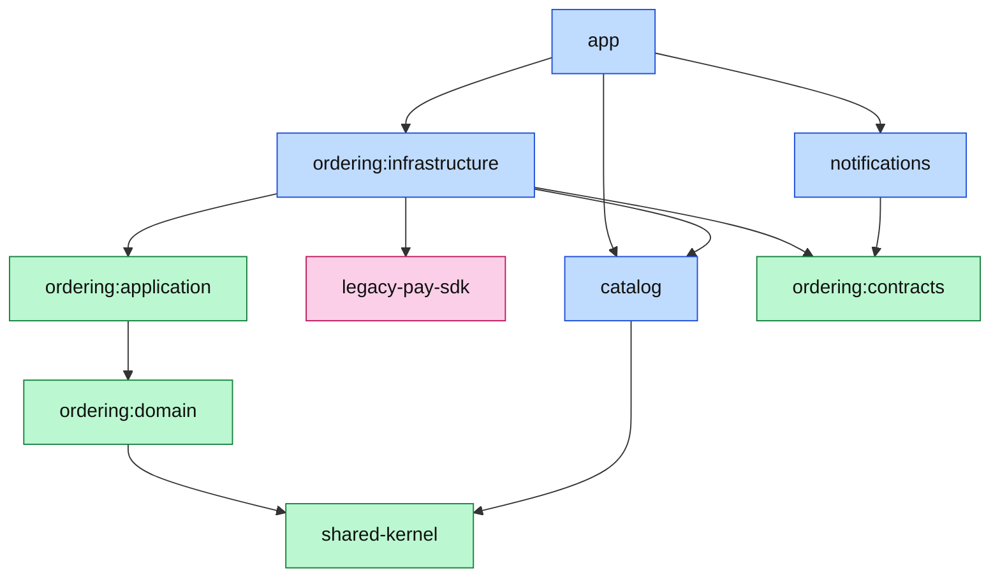

En verde, Java puro; en azul, Spring; en rosa, el tercero. ¿Cómo llama el caso de uso a JPA si no
puede depender de ella? Con **inversión de dependencias** (la D de SOLID):

```text
PlaceOrderService ──usa──▶ OrderRepository (interfaz, en el dominio)
                                    ▲
                                    │ implementa
                           JpaOrderRepository (infraestructura)

En tiempo de ejecución Spring inyecta JpaOrderRepository donde se pide OrderRepository.
En los tests se pasa InMemoryOrderRepository con new.
```

El flujo de una petición atraviesa el hexágono de fuera a dentro y vuelve a salir:
`HTTP → OrderController → PlaceOrderUseCase → PlaceOrderService → Order → OrderRepository → JpaOrderRepository → H2`.

### 5.6 Quién vigila la regla: el compilador y ArchUnit

Una estructura de paquetes que nadie comprueba se degrada en meses, así que aquí la regla tiene dos
guardianes.

**1. El compilador (módulos de Gradle).** El dominio no tiene Spring en su classpath. Esto se
probó metiendo una clase con `@Service` en `ordering/domain`:

```text
> Task :ordering:domain:compileJava FAILED
Leak.java:3: error: package org.springframework.stereotype does not exist
```

**2. ArchUnit**, para lo que el compilador no ve: qué paquete usa qué dentro de un módulo y los
límites entre contextos. Las 12 reglas de [`ArchitectureTest`][ArchitectureTest]:

| Regla | Protege |
|---|---|
| `dependenciesPointInwards` | Dominio ← aplicación ← infraestructura, nunca al revés |
| `theCoreIsFrameworkFree` | Ni Spring, ni `jakarta.*`, ni Hibernate, ni Jackson en el núcleo |
| `drivingAdaptersDoNotUseDrivenAdapters` | Un controlador no habla con la base de datos |
| `drivenAdaptersDoNotUseDrivingAdapters` | Ni al revés |
| `noFieldInjection` | Dependencias por constructor |
| `onlyTheAntiCorruptionLayerKnowsLegacyPay` | El SDK de terceros no cruza la ACL |
| `orderingUsesCatalogOnlyThroughItsOpenHostService` | Nadie toca `catalog.internal` |
| `onlyTheCatalogAdapterTalksToCatalog` | El núcleo de Ordering usa su puerto, no Catalog |
| `theUpstreamDoesNotKnowItsDownstreams` | Catalog no sabe que existen Ordering ni Notifications |
| `notificationsConformsToThePublishedLanguageOnly` | Notifications solo ve `ordering.contracts` |
| `notificationsAndCatalogGoSeparateWays` | Sin integración entre ellos |
| `thePublishedLanguageIsMadeOfJdkTypesOnly` | Los contratos no arrastran el modelo interno |

Se comprobó que una regla falla de verdad metiendo un campo `LegacyPayClient` en el paquete
`config`:

```text
ArchitectureTest > onlyTheAntiCorruptionLayerKnowsLegacyPay FAILED
    Rule 'no classes that reside outside of packages [...out.payment.., com.legacypay..] should depend
    on classes that reside in a package 'com.legacypay..', because el modelo de LegacyPay no cruza la ACL'
    was violated (1 times):
    Field <...infrastructure.config.Leak.client> has type <com.legacypay.sdk.LegacyPayClient>
```

### 5.7 Spring vive en el anillo de fuera

Las clases del núcleo se crean con `new` y se registran como beans desde
[`OrderingConfiguration`][OrderingConfiguration], en infraestructura. Ahí también se pone la
transacción: como cada puerto de entrada tiene un único método, el envoltorio transaccional es una
lambda que **implementa el mismo puerto**:

```java
@Bean
PlaceOrderUseCase placeOrderUseCase(OrderRepository orders, ProductCatalog catalog,
    UnpaidOrdersLimit unpaidOrdersLimit, DomainEventPublisher events, Clock clock,
    PlatformTransactionManager transactionManager) {
  var useCase = new PlaceOrderService(orders, catalog, unpaidOrdersLimit, events, clock);
  var tx = new TransactionTemplate(transactionManager);
  return command -> tx.execute(status -> useCase.place(command));   // un caso de uso = una transacción
}
```

El controlador recibe un `PlaceOrderUseCase` y no sabe si detrás hay una transacción, un log o un
reintento. Es la versión pura de "`@Transactional` en el caso de uso": la transacción está en el
límite del caso de uso, pero la anotación no ensucia el núcleo. La opción pragmática, aceptar
`@Transactional` en la capa de aplicación, también es defendible; aquí se ha elegido la pura para que
se vea que es posible.

Los adaptadores sí llevan `@Component`, `@Repository` o `@RestController`, porque viven fuera del
núcleo y ahí Spring es bienvenido. `spring.jpa.open-in-view=false` asegura que la sesión de JPA no
se escape del caso de uso.

### 5.8 Modelo de dominio frente a modelo de persistencia

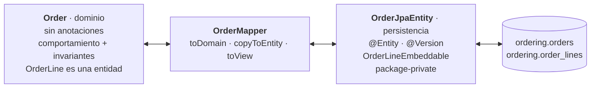

Es la opción **purista**: el dominio no conoce `jakarta.persistence`, y las restricciones de JPA
(constructor vacío, setters, proxies, `@Version`) se quedan en [`OrderJpaEntity`][OrderJpaEntity],
que es package-private y nadie fuera del adaptador puede usar. El precio es [`OrderMapper`][OrderMapper],
unas decenas de líneas. Fíjate en que el modelo de persistencia **no copia** al de dominio: en el
dominio `OrderLine` es una entidad, y en la base de datos basta una `@ElementCollection` de valores.

La alternativa pragmática (anotar `Order` con JPA) también es defendible si se asume el
acoplamiento. Se compensa en el core y no en todas partes: por eso Catalog usa la entidad JPA
directamente.

### 5.9 Lectura por el lado (CQRS ligero)

Los comandos pasan por el agregado porque escriben y tienen reglas. La consulta `GET /orders/{id}`
**no**: [`GetOrderService`][GetOrderService] va al puerto [`OrderViews`][OrderViews], cuyo adaptador
construye un [`OrderView`][OrderView] plano directamente desde las tablas, sin reconstruir `Order`.
Leer no tiene invariantes que proteger, así que el lado de lectura se optimiza para quien lee. Hoy
son las mismas tablas; mañana podría ser una proyección o una caché sin tocar el dominio.

### 5.10 Un caso de uso, varias entradas

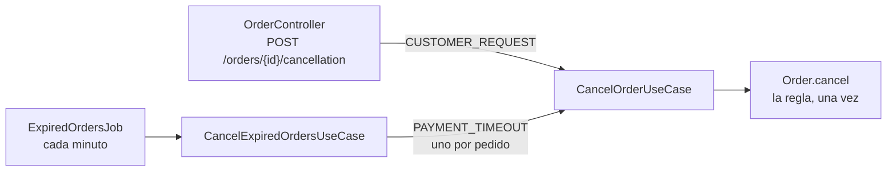

Sin hexagonal, la lógica acabaría copiada en el controlador y en el job, o el job llamaría al
controlador. Aquí los dos adaptadores llegan al mismo puerto, y la regla "un pedido enviado no se
cancela" protege los dos caminos.

### 5.11 Hexagonal no es todo o nada

| Nivel | Qué es | En este proyecto |
|---|---|---|
| 0 · Capas clásicas | Controller → Service → Spring Data | **Catalog** |
| 1 · Puertos solo hacia fuera | Interfaz para lo externo que cambia (pasarela, otro servicio) | No se usa: Notifications es tan pequeño que el contexto entero es, en la práctica, un adaptador |
| 2 · Núcleo sin framework | Dominio y casos de uso en Java puro, beans desde configuración, ArchUnit | Ordering lo cumple… |
| 3 · Límites que impone el compilador | Módulos separados por anillo | …y además esto: **Ordering** |

Se sube de nivel solo cuando el problema lo pide. Ordering está en el 3 para que se vea el extremo;
en un equipo real, el 2 con ArchUnit suele bastar.

---

## 6. Recorridos completos, paso a paso

### 6.1 Realizar un pedido

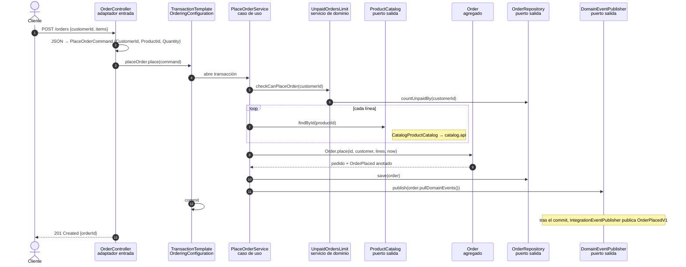

### 6.2 Pagar: la ACL en acción

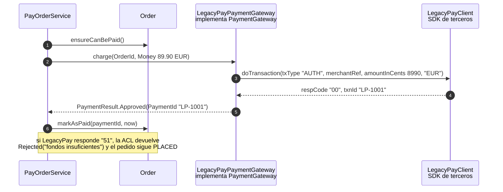

| Ordering habla de… | LegacyPay habla de… | Traduce |
|---|---|---|
| `Money.euros("89.90")` | `amountInCents = 8990`, `currencyIso = "EUR"` | `toCents` |
| `OrderId` | `merchantRef` | `orderId.toString()` |
| `charge` / `refund` | `txType = "AUTH"` / `"RFND"` | un método por operación |
| `PaymentResult.Approved(PaymentId)` | `respCode = "00"`, `txnId` | `switch` |
| `PaymentResult.Rejected("fondos insuficientes")` | `respCode = "51"` | `switch` |

### 6.3 Cancelar un pedido pagado: reembolso y email por eventos

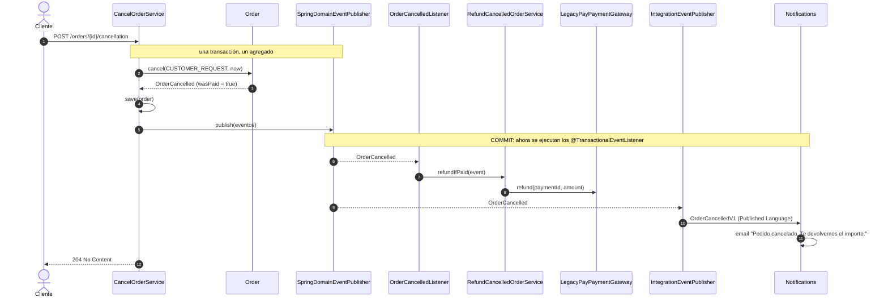

`CancelOrderService` no sabe que existen el reembolso ni los emails. Son reacciones a un hecho, y
solo ocurren si la cancelación quedó guardada (**tras el commit**). Esa es la consistencia eventual
entre agregados y contextos.

### 6.4 Caducar pedidos

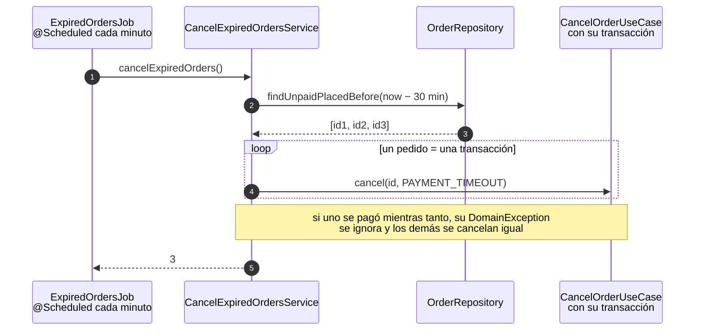

---

## 7. Los tests como prueba de la arquitectura

| Nivel | Qué prueba | ¿Spring? | ¿BD? | Tests | Tiempo |
|---|---|---|---|---|---|
| Value objects | [`MoneyTest`][MoneyTest] | No | No | 6 | 0,05 s |
| Dominio | [`OrderTest`][OrderTest], [`UnpaidOrdersLimitTest`][UnpaidOrdersLimitTest] | No | No | 19 | **0,08 s** |
| Casos de uso con fakes de los puertos | [`PlaceOrderServiceTest`][PlaceOrderServiceTest], [`PayOrderServiceTest`][PayOrderServiceTest], [`CancellationTest`][CancellationTest] | No | No | 11 | 0,09 s |
| ACL | [`LegacyPayPaymentGatewayTest`][LegacyPayPaymentGatewayTest] | No | No | 3 | 0,06 s |
| Arquitectura | [`ArchitectureTest`][ArchitectureTest] | No | No | 12 | 1,0 s |
| End-to-end | [`OrderLifecycleTest`][OrderLifecycleTest] | Sí | H2 | 6 | 4,3 s |

Las reglas de negocio se prueban con `new` y cada test se lee como la regla que comprueba:

```java
@Test
void aShippedOrderCannotBeCancelled() {
  Order order = paidOrder();
  order.ship(NOW);

  assertThatThrownBy(() -> order.cancel(CancellationReason.CUSTOMER_REQUEST, NOW))
      .isInstanceOf(OrderAlreadyShipped.class);
}
```

Y los casos de uso, con la segunda implementación de cada puerto. Probar "la pasarela rechaza el
cobro" no necesita levantar nada:

```java
@Test
void aRejectedPaymentLeavesTheOrderUnpaid() {
  OrderId orderId = existingOrder();
  paymentGateway.rejectEverythingBecause("Fondos insuficientes");

  assertThatThrownBy(() -> payOrder.pay(orderId)).isInstanceOf(PaymentRejected.class);
  assertThat(orders.findById(orderId).orElseThrow().status()).isEqualTo(OrderStatus.PLACED);
}
```

El [`InMemoryOrderRepository`][InMemoryOrderRepository] guarda y devuelve **copias**, como una base
de datos real: si un caso de uso cambia un pedido y olvida llamar a `save`, el test lo detecta. Los
end-to-end son pocos a propósito: no prueban reglas (eso ya está hecho en milisegundos), prueban que
las piezas encajan.

---

## 8. Antipatrones que este proyecto evita

| Antipatrón | Cómo se evita aquí |
|---|---|
| Agregado enorme ("Customer con todos sus pedidos") | `Order` solo contiene sus líneas; el cliente es un `CustomerId` |
| Una transacción que toca varios agregados | Un caso de uso = un agregado; caducar N pedidos son N transacciones |
| Entidad JPA = modelo de dominio sin pensarlo | `Order` y `OrderJpaEntity` separados, con mapper (decisión consciente, sección 5.8) |
| Compartir entidades entre contextos | Se comparten contratos (`contracts`) y un kernel diminuto (`Money`), nunca entidades |
| DDD táctico en un CRUD | Catalog es CRUD y no lo tiene, a propósito |
| Modelo anémico donde hay reglas | `Order` sin setters, con verbos de negocio |
| Puertos con forma de tecnología (`saveRow`, `sendToTopic`) | `OrderRepository.save(order)`, `PaymentGateway.charge(...)` |
| Puerto que devuelve tipos del adaptador | `OrderRepository` devuelve `Order`; la entidad JPA es package-private |
| Lógica de negocio en los adaptadores | El controlador y el job solo traducen; ArchUnit impide que un adaptador de entrada use uno de salida |
| Interfaces para todo | `UnpaidOrdersLimit`, `OrderMapper` y los servicios de Catalog son clases: interfaces solo donde hay frontera |
| Dominio con `@Service` / `@Transactional` | Imposible: el módulo no compila con Spring |
| Reglas de arquitectura sin verificar | 12 reglas de ArchUnit + módulos de Gradle |
| Eventos de dominio publicados hacia fuera tal cual | Se traducen a eventos de integración versionados |

---

## 9. Decisiones y lo que cambiaría en producción

Este proyecto prioriza que cada concepto se vea claro. Esto es lo que se simplificó y cómo sería en
un sistema real:

| Aquí | Por qué | En producción |
|---|---|---|
| Eventos en memoria de Spring tras el commit | Cero infraestructura, y se ve el flujo | **Outbox transaccional** + Kafka: si el proceso muere entre el commit y el listener, aquí el evento se pierde. Solo cambiaría `IntegrationEventPublisher` y `SpringDomainEventPublisher` |
| H2 en memoria con `ddl-auto` | Arranca sin nada instalado | PostgreSQL con Flyway, un esquema o una base de datos por contexto |
| El cobro va dentro de la transacción de BD | Simplicidad | Idempotencia por `merchantRef` (ya es el id del pedido) y, si el cobro tarda, un saga o un estado `PAYMENT_PENDING` |
| El reembolso fallido lanza una excepción en el listener | Simplicidad | Reintentos con backoff y un estado `REFUND_PENDING` visible para soporte |
| Puertos de entrada con una implementación | Pureza, y son la costura de la transacción | Defendible omitirlos y llamar al caso de uso directamente |
| Mapper dominio ↔ JPA | Ver la opción purista | Se mantiene en el core; en contextos sencillos, la entidad JPA directa (como Catalog) |
| Nivel 3 de hexagonal (módulos de Gradle) | Que se vea el extremo | Nivel 2 con ArchUnit suele bastar; nivel 3 con equipos grandes o mucha rotación |
| Monolito modular | Beneficios del modelo sin coste de red | Igual al principio; se extrae un contexto solo cuando necesite escalar o desplegarse aparte |

---

## 10. Chuleta: cada concepto y dónde está

### DDD estratégico

| Concepto | Dónde | En una línea |
|---|---|---|
| Dominio y subdominios | [Sección 3.1](#31-subdominios-dónde-se-invierte-y-dónde-no) | Ordering core, Catalog supporting, pagos y emails generic |
| Lenguaje ubicuo | [Sección 3.2](#32-lenguaje-ubicuo), excepciones, `title` del API | Las palabras de negocio, tal cual, hasta en los errores HTTP |
| Bounded context | Un módulo, un paquete y un esquema por contexto | "Producto" es `ProductView` en Catalog y `OrderLine` en Ordering |
| Customer/Supplier | [`CatalogApi`][CatalogApi] ← [`CatalogProductCatalog`][CatalogProductCatalog] | Catalog sirve a Ordering lo que necesita |
| Open Host Service | Paquete `catalog.api` | La única puerta pública de Catalog |
| Published Language | Módulo [`ordering/contracts`][contracts] | Eventos `V1` con tipos del JDK |
| Anticorruption Layer | [`LegacyPayPaymentGateway`][LegacyPayPaymentGateway] | El modelo del tercero no entra |
| Conformist | [`OrderNotificationsListener`][OrderNotificationsListener] | Usa los eventos de Ordering sin traducirlos |
| Shared Kernel | [`Money`][Money] | Diminuto y coordinado |
| Separate Ways | Notifications ↔ Catalog | Sin integración, comprobado por ArchUnit |
| Event Storming | [Sección 2.1](#21-event-storming) | De los post-its salen las clases |
| Monolito modular | [Sección 3.5](#35-por-qué-un-monolito-modular-y-no-microservicios) | El corte hecho, sin la red |

### DDD táctico

| Concepto | Dónde | En una línea |
|---|---|---|
| Value Object | [`Money`][Money], [`Quantity`][Quantity], [`OrderId`][OrderId]… | Igualdad por valor, inmutable, válido al nacer |
| Entidad | [`Order`][Order], [`OrderLine`][OrderLine] | Igualdad por identidad |
| Agregado y raíz | [`Order`][Order] + [`AggregateRoot`][AggregateRoot] | Unidad de consistencia; todo pasa por la raíz |
| Invariantes | Javadoc y métodos de `Order` | R1, R4, R5, R6 de la [tabla de reglas](#22-las-reglas-de-negocio-dónde-viven-y-qué-test-las-prueba) |
| Reglas de Vernon | [Sección 4.3](#43-agregado-y-aggregate-root) | Pequeño, por id, una transacción, eventos entre agregados |
| Modelo rico | `Order.cancel` frente al anémico de la [sección 4.4](#44-modelo-rico-frente-a-modelo-anémico) | Tell, don't ask |
| Factory | `Order.place` frente a `Order.reconstitute` | Crear valida y emite; reconstruir no |
| Domain Event | [`DomainEvent`][DomainEvent] (sealed) y sus 4 records | Hechos en pasado, internos |
| Evento de integración | [`OrderCancelledV1`][OrderCancelledV1]… | Contrato público y versionado |
| Repository | [`OrderRepository`][OrderRepository] | Colección de agregados; interfaz en el dominio |
| Domain Service | [`UnpaidOrdersLimit`][UnpaidOrdersLimit] | Regla entre varios agregados, sin estado |
| Application Service | [`PlaceOrderService`][PlaceOrderService] y compañía | Orquesta, no decide |
| Política (Event Storming) | [`RefundCancelledOrderService`][RefundCancelledOrderService], [`CancelExpiredOrdersService`][CancelExpiredOrdersService] | "Cuando X, entonces Y" |
| Excepciones de dominio | [`DomainException`][DomainException] y subclases | Una por regla, con su nombre |

### Arquitectura hexagonal

| Concepto | Dónde | En una línea |
|---|---|---|
| Núcleo sin framework | `ordering/domain` + `ordering/application` | Java puro; el compilador lo garantiza |
| Puerto de entrada | [`port/in`](ordering/application/src/main/java/com/borjaglez/dddlab/ordering/application/port/in) | Lo que la aplicación ofrece |
| Puerto de salida | [`port/out`](ordering/application/src/main/java/com/borjaglez/dddlab/ordering/application/port/out) + `OrderRepository` | Lo que la aplicación necesita, en su idioma |
| Adaptador de entrada | `infrastructure/in`: REST, job, listener | Traduce el exterior a una llamada a un puerto |
| Adaptador de salida | `infrastructure/out`: JPA, catálogo, ACL, eventos | Implementa un puerto con tecnología |
| Regla de dependencias + DIP | [Sección 5.5](#55-la-regla-de-dependencias) | Las flechas apuntan hacia dentro |
| Verificación | Módulos de Gradle + [`ArchitectureTest`][ArchitectureTest] | El build falla si alguien se salta la regla |
| Composition root | [`OrderingConfiguration`][OrderingConfiguration] | El único sitio donde Spring conoce el núcleo |
| Transacción en el límite del caso de uso | Lambdas con `TransactionTemplate` | Sin `@Transactional` en el núcleo |
| Dominio ≠ persistencia | [`OrderMapper`][OrderMapper], [`OrderJpaEntity`][OrderJpaEntity] | JPA no deforma el dominio |
| Fakes de los puertos | [`fakes/`](ordering/application/src/test/java/com/borjaglez/dddlab/ordering/application/fakes) | La segunda implementación de cada puerto |
| Varias entradas, un caso de uso | REST + job → `CancelOrderUseCase` | La regla está una vez |
| CQRS ligero | [`GetOrderQuery`][GetOrderService] + [`OrderViews`][OrderViews] | Las lecturas no pasan por el agregado |
| Niveles de adopción | Catalog nivel 0, Ordering nivel 3 | Aislamiento según lo que haya que proteger |

---

## 11. Ejercicios para practicar

Cada ejercicio comprueba si la arquitectura cumple lo que promete. Si te obliga a tocar algo fuera
de lo indicado, algo está mal diseñado.

1. **Cambia de pasarela.** Escribe un `StripePaymentGateway` que implemente `PaymentGateway`.
   *Solo deberías tocar* `ordering/infrastructure/out/payment`. El dominio, los casos de uso y sus
   tests no cambian.
2. **Añade una entrada nueva.** Un `CommandLineRunner` que cancele un pedido por id desde la
   consola. *Solo* `infrastructure/in`, y llamando a `CancelOrderUseCase`.
3. **Añade un contexto Inventory** que reserve stock al recibir `OrderPlacedV1`. *No deberías tocar
   Ordering*: es un suscriptor más del Published Language. ¿Qué patrón del context map usarías?
4. **Añade una regla:** "envío gratis en pedidos de más de 100 €". ¿Va en `Order`, en un servicio de
   dominio o en el caso de uso? Escribe primero el test en `OrderTest`.
5. **Rompe la arquitectura a propósito:** importa `OrderJpaEntity` desde `OrderController`, o añade
   `@Service` a `UnpaidOrdersLimit`. Lanza `./gradlew test` y lee qué falla y por qué.
6. **Extrae Catalog a un microservicio** (sobre el papel). ¿Qué clases de Ordering cambian? La
   respuesta correcta es una: `CatalogProductCatalog`.
7. **Pasa de eventos en memoria a un outbox.** ¿Qué adaptador cambia? ¿Cambia algún caso de uso?

<!-- Enlaces a las clases citadas -->

[domain-build]: ordering/domain/build.gradle.kts
[application.yml]: app/src/main/resources/application.yml
[contracts]: ordering/contracts/src/main/java/com/borjaglez/dddlab/ordering/contracts
[Money]: shared-kernel/src/main/java/com/borjaglez/dddlab/sharedkernel/Money.java
[Order]: ordering/domain/src/main/java/com/borjaglez/dddlab/ordering/domain/Order.java
[OrderLine]: ordering/domain/src/main/java/com/borjaglez/dddlab/ordering/domain/OrderLine.java
[OrderStatus]: ordering/domain/src/main/java/com/borjaglez/dddlab/ordering/domain/OrderStatus.java
[OrderId]: ordering/domain/src/main/java/com/borjaglez/dddlab/ordering/domain/OrderId.java
[CustomerId]: ordering/domain/src/main/java/com/borjaglez/dddlab/ordering/domain/CustomerId.java
[ProductId]: ordering/domain/src/main/java/com/borjaglez/dddlab/ordering/domain/ProductId.java
[PaymentId]: ordering/domain/src/main/java/com/borjaglez/dddlab/ordering/domain/PaymentId.java
[Quantity]: ordering/domain/src/main/java/com/borjaglez/dddlab/ordering/domain/Quantity.java
[AggregateRoot]: ordering/domain/src/main/java/com/borjaglez/dddlab/ordering/domain/AggregateRoot.java
[OrderRepository]: ordering/domain/src/main/java/com/borjaglez/dddlab/ordering/domain/OrderRepository.java
[UnpaidOrdersLimit]: ordering/domain/src/main/java/com/borjaglez/dddlab/ordering/domain/UnpaidOrdersLimit.java
[DomainEvent]: ordering/domain/src/main/java/com/borjaglez/dddlab/ordering/domain/event/DomainEvent.java
[OrderCancelled]: ordering/domain/src/main/java/com/borjaglez/dddlab/ordering/domain/event/OrderCancelled.java
[DomainException]: ordering/domain/src/main/java/com/borjaglez/dddlab/ordering/domain/exception/DomainException.java
[OrderAlreadyShipped]: ordering/domain/src/main/java/com/borjaglez/dddlab/ordering/domain/exception/OrderAlreadyShipped.java
[PlaceOrderUseCase]: ordering/application/src/main/java/com/borjaglez/dddlab/ordering/application/port/in/PlaceOrderUseCase.java
[OrderView]: ordering/application/src/main/java/com/borjaglez/dddlab/ordering/application/port/in/OrderView.java
[ProductCatalog]: ordering/application/src/main/java/com/borjaglez/dddlab/ordering/application/port/out/ProductCatalog.java
[PaymentGateway]: ordering/application/src/main/java/com/borjaglez/dddlab/ordering/application/port/out/PaymentGateway.java
[DomainEventPublisher]: ordering/application/src/main/java/com/borjaglez/dddlab/ordering/application/port/out/DomainEventPublisher.java
[OrderViews]: ordering/application/src/main/java/com/borjaglez/dddlab/ordering/application/port/out/OrderViews.java
[PlaceOrderService]: ordering/application/src/main/java/com/borjaglez/dddlab/ordering/application/service/PlaceOrderService.java
[CancelExpiredOrdersService]: ordering/application/src/main/java/com/borjaglez/dddlab/ordering/application/service/CancelExpiredOrdersService.java
[RefundCancelledOrderService]: ordering/application/src/main/java/com/borjaglez/dddlab/ordering/application/service/RefundCancelledOrderService.java
[GetOrderService]: ordering/application/src/main/java/com/borjaglez/dddlab/ordering/application/service/GetOrderService.java
[OrderingConfiguration]: ordering/infrastructure/src/main/java/com/borjaglez/dddlab/ordering/infrastructure/config/OrderingConfiguration.java
[OrderController]: ordering/infrastructure/src/main/java/com/borjaglez/dddlab/ordering/infrastructure/in/rest/OrderController.java
[OrderingExceptionHandler]: ordering/infrastructure/src/main/java/com/borjaglez/dddlab/ordering/infrastructure/in/rest/OrderingExceptionHandler.java
[ExpiredOrdersJob]: ordering/infrastructure/src/main/java/com/borjaglez/dddlab/ordering/infrastructure/in/scheduling/ExpiredOrdersJob.java
[OrderCancelledListener]: ordering/infrastructure/src/main/java/com/borjaglez/dddlab/ordering/infrastructure/in/events/OrderCancelledListener.java
[JpaOrderRepository]: ordering/infrastructure/src/main/java/com/borjaglez/dddlab/ordering/infrastructure/out/persistence/JpaOrderRepository.java
[JpaOrderViews]: ordering/infrastructure/src/main/java/com/borjaglez/dddlab/ordering/infrastructure/out/persistence/JpaOrderViews.java
[OrderJpaEntity]: ordering/infrastructure/src/main/java/com/borjaglez/dddlab/ordering/infrastructure/out/persistence/OrderJpaEntity.java
[OrderMapper]: ordering/infrastructure/src/main/java/com/borjaglez/dddlab/ordering/infrastructure/out/persistence/OrderMapper.java
[CatalogProductCatalog]: ordering/infrastructure/src/main/java/com/borjaglez/dddlab/ordering/infrastructure/out/catalog/CatalogProductCatalog.java
[LegacyPayPaymentGateway]: ordering/infrastructure/src/main/java/com/borjaglez/dddlab/ordering/infrastructure/out/payment/LegacyPayPaymentGateway.java
[SpringDomainEventPublisher]: ordering/infrastructure/src/main/java/com/borjaglez/dddlab/ordering/infrastructure/out/events/SpringDomainEventPublisher.java
[IntegrationEventPublisher]: ordering/infrastructure/src/main/java/com/borjaglez/dddlab/ordering/infrastructure/out/events/IntegrationEventPublisher.java
[OrderCancelledV1]: ordering/contracts/src/main/java/com/borjaglez/dddlab/ordering/contracts/OrderCancelledV1.java
[CatalogApi]: catalog/src/main/java/com/borjaglez/dddlab/catalog/api/CatalogApi.java
[ProductView]: catalog/src/main/java/com/borjaglez/dddlab/catalog/api/ProductView.java
[Product]: catalog/src/main/java/com/borjaglez/dddlab/catalog/internal/Product.java
[CatalogService]: catalog/src/main/java/com/borjaglez/dddlab/catalog/internal/CatalogService.java
[OrderNotificationsListener]: notifications/src/main/java/com/borjaglez/dddlab/notifications/OrderNotificationsListener.java
[ArchitectureTest]: app/src/test/java/com/borjaglez/dddlab/ArchitectureTest.java
[OrderLifecycleTest]: app/src/test/java/com/borjaglez/dddlab/OrderLifecycleTest.java
[OrderTest]: ordering/domain/src/test/java/com/borjaglez/dddlab/ordering/domain/OrderTest.java
[UnpaidOrdersLimitTest]: ordering/domain/src/test/java/com/borjaglez/dddlab/ordering/domain/UnpaidOrdersLimitTest.java
[MoneyTest]: shared-kernel/src/test/java/com/borjaglez/dddlab/sharedkernel/MoneyTest.java
[PlaceOrderServiceTest]: ordering/application/src/test/java/com/borjaglez/dddlab/ordering/application/service/PlaceOrderServiceTest.java
[PayOrderServiceTest]: ordering/application/src/test/java/com/borjaglez/dddlab/ordering/application/service/PayOrderServiceTest.java
[CancellationTest]: ordering/application/src/test/java/com/borjaglez/dddlab/ordering/application/service/CancellationTest.java
[InMemoryOrderRepository]: ordering/application/src/test/java/com/borjaglez/dddlab/ordering/application/fakes/InMemoryOrderRepository.java
[LegacyPayPaymentGatewayTest]: ordering/infrastructure/src/test/java/com/borjaglez/dddlab/ordering/infrastructure/out/payment/LegacyPayPaymentGatewayTest.java
